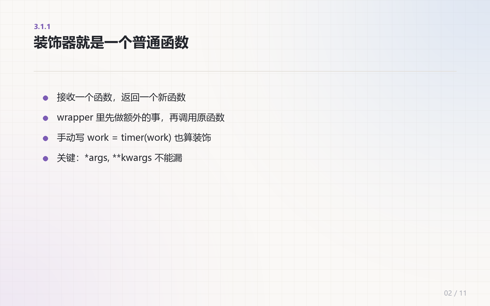
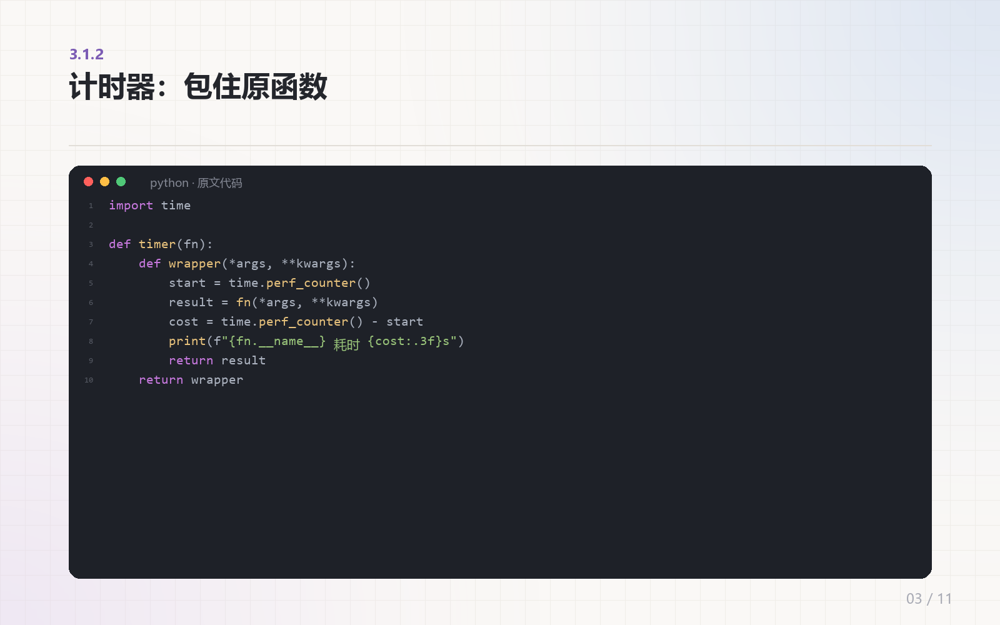

# ai-course-video · 把 Markdown 教程变成 AI 教学视频

> 一份 Markdown 教程进，一支能直接发 B 站 / 视频号的编程教学视频出。
> **一幕一页 + 逐句 TTS + 字幕实测对齐**，画面、口播、字幕三条时间轴不再各算各的。

[](https://www.python.org/)
[](LICENSE)
[](https://www.microsoft.com/windows)
[](https://github.com/ztl0001)

---

## 它长什么样

| 知识卡（原文提炼） | 代码页（逐行原样） |
|---|---|
|  |  |

| 片头钩子 | 片尾 |
|---|---|
|  |  |

1600×1000、浅色纸底 + 细网格、代码深色终端 + 语法高亮、中英 emoji 三分支混排。

---

## 它解决什么

把文档做成视频，麻烦的从来不是画面，是**对齐**：

| 常见做法 | 结果 |
|---|---|
| 录屏 + 剪映手动配音 | 一条 5 分钟视频要剪 4 小时，改一句话全片重剪 |
| 一块代码配一段口播，再平均切页 | 越到后面越不同步，最后 30 秒画面和声音完全对不上 |
| 字幕按字数估算时长 | 中文语速不均匀，累计误差肉眼可见 |
| 把原文整段贴成字幕 | 观众读不完，代码又看不清 |

这个 Skill 把三件事写死成流程：

1. **一幕一页** —— 一个代码块按行分页，每页一个独立场景、一段独立口播、一段独立音频。
2. **逐句 TTS** —— 口播按句号切句，每句单独合成，`ffprobe` 量真实时长，字幕起止直接写实测值。
3. **原文提炼成卡** —— 段落转成「标题 + 3~5 条要点」，代码例外：逐行原样保留，只允许分页。

**每个代码块的页数必须等于该块的口播条数**，生成前断言，不等就报错。这是不跑偏的前提。

---

## 快速开始

```bash
# 0) 环境：Python 3.12 + ffmpeg + edge-tts
py -3.12 -m pip install edge-tts pillow
ffmpeg -version

# 1) 解析文档 → scenes.json 骨架
py -3.12 scripts/extract.py --md examples/tutorial.md --out ./video-out

# 2) 填 scenes.json 的 label / title / points / voice（见 examples/fill_scenes.py）
#    自检：每个代码块 len(voices) == 页数

# 3) 渲染画面
py -3.12 scripts/render.py --scenes ./video-out/scenes.json --out ./video-out/slides

# 4) 配音 + 字幕 + 合成（可选 BGM）
py -3.12 scripts/build.py --scenes ./video-out/scenes.json --out ./video-out \
    --voice zh-CN-YunyangNeural --rate +8% --gap 0.7 \
    --bgm bgm.mp3 --name 课程-01.mp4
```

> 改口播只需改 `scenes.json` 再重跑第 4 步。**`vo/` 目录必须换名或清空**，否则会跳过已存在的音频。

---

## 四步流程

```
Markdown ──extract.py──▶ scenes.json ──render.py──▶ slides/*.png
                              │
                              ├──build.py（逐句 TTS）──▶ vo/*.mp3
                              └──build.py（字幕+合成）──▶ 成片.mp4
```

### 1. 解析（`extract.py`）

按 ``` 围栏把文档切成 `code` / `text` 两类块，代码块自动分页：

```python
npg = max(1, (len(rows) + 17) // 18)   # 每页最多 18 行
per = (len(rows) + npg - 1) // npg      # 先算页数再均分，避免最后一页只剩 2 行
```

### 2. 规划（人工或模型）

每幕确定 `kind`（`hook` / `title` / `text` / `code` / `image` / `end`）和 `voice`。
`text` 幕必须写成提炼卡，不要贴原文。

### 3. 渲染（`render.py`）

三种版式：文字卡（紫点列表，字号 30 / 行高 48）、代码页（深色终端、行号、语法高亮、超宽自动缩字号）、图片页（白底卡片）。

代码页会测量最长行宽度，超过安全宽度就整页缩字号（最低 14px），**不裁切、不换行**。

### 4. 合成（`build.py`）

```
逐句 TTS → 量时长 → concat 成整幕音频
每幕：静态画面 + 音频，时长 = 音频 + gap
concat → 烧字幕（ASS）→ loudnorm -16 LUFS → 混 BGM（比口播低 9 dB）
```

---

## 输出结构

```
video-out/
├── 课程-01.mp4               成片
├── scenes.json                场景表（含口播，唯一需要改的源）
├── slides/                    画面 PNG
├── vo/                        逐句音频
└── subs.ass                   字幕
```

---

## 三种版式

| 类型 | 版式 |
|---|---|
| 文字卡 | 标题 + 紫色圆点列表，字号 30，行高 48 |
| 代码页 | 深色终端（`#1E2128`），行号 + 语法高亮，字号自适应 |
| 图片页 | 白底卡片 + 细边框，居中，底部留字幕区 |

中文用微软雅黑、ASCII 用 Consolas、emoji 用 Segoe UI Emoji，**三者混排**，否则中文注释会变成方块。

---

## 常见坑

| 现象 | 原因 | 解法 |
|---|---|---|
| 越到后面越不同步 | 一块一音频再均分画面 | 一幕一页，一页一音频 |
| 字幕比语音慢/快 | 按字数估时长 | 逐句 TTS + `ffprobe` 实测 |
| 代码后几页没讲解 | 口播条数 < 页数 | 生成前断言，数量必须相等 |
| 中文注释变方块 | Consolas 不含中文 | 中英 emoji 三分支混排 |
| 长签名行被裁 | 固定字号 | 测最长行，整页缩字号 |
| 最后一页只剩两行 | 18 行硬切 | 先算页数再均分 |
| BGM 盖人声 | 只按峰值估 | 按均值算，目标低 9 dB |
| ASS 字幕全丢 | Dialogue 行没换行 | 每行末尾必须换行 |
| 峰值 0 dB 削波 | 口播 + BGM 叠加 | `alimiter=limit=0.89:level=0` |

更多参数、色板、ffmpeg 命令见 [reference.md](reference.md)；每个脚本要改哪里见 [scripts/README.md](scripts/README.md)。

---

## 示例

`examples/` 里有一份完整的输入输出：

| 文件 | 说明 |
|---|---|
| [tutorial.md](examples/tutorial.md) | 输入：装饰器一节的 Markdown 教程 |
| [fill_scenes.py](examples/fill_scenes.py) | 填 `label/title/points/voice` 的示例 |
| [scenes.json](examples/scenes.json) | 11 幕场景表（含口播） |
| [slides/](examples/slides/) | 四张渲染结果 |

复现：

```bash
cd examples
py -3.12 ../scripts/extract.py --md tutorial.md --out .
py -3.12 fill_scenes.py
py -3.12 ../scripts/render.py --scenes scenes.json --out out
```

---

## 作为 DeepSeek Harness Skill 使用

把仓库放到 Skill 目录即可被助手自动识别：

```bash
git clone https://github.com/ztl0001/ai-course-video "%USERPROFILE%\.dsh\skills\ai-course-video"
```

之后直接说「把这篇文档做成教学视频」，助手会按 `SKILL.md` 走完整流程。

---

## 能力边界

- 代码高亮目前只内置 Python；换语言改 `scripts/common.py` 的 `KEYWORDS` 与 `tokenize()`
- 画面固定 1600×1000；要竖屏需要改 `common.py` 的 `W/H` 和版式坐标
- 口播用 Edge TTS（免费、无需 Key）；需要特定音色可替换 `build.py` 的 `_tts()`
- 只负责「文档 → 视频」，不包含上传；发布可搭配 [real-demo-video](https://github.com/ztl0001/real-demo-video) 的封面与发布流程

---

## 素材授权提醒

- BGM 选 Mixkit（Free License，可商用免署名）、Pixabay（多数可商用）或 CC BY 素材（需署名）
- 教程原文 / 代码 / 配图看源仓库 LICENSE；CC BY-NC-SA 的内容不能进商业产品

---

## License

[MIT](LICENSE) © 2026 ztl0001

如果这个 Skill 帮你省下了剪视频的时间，点个 **Star** 让更多人看到。
